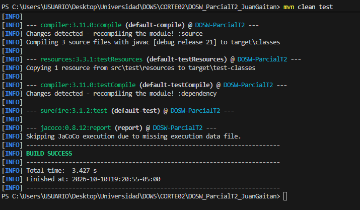
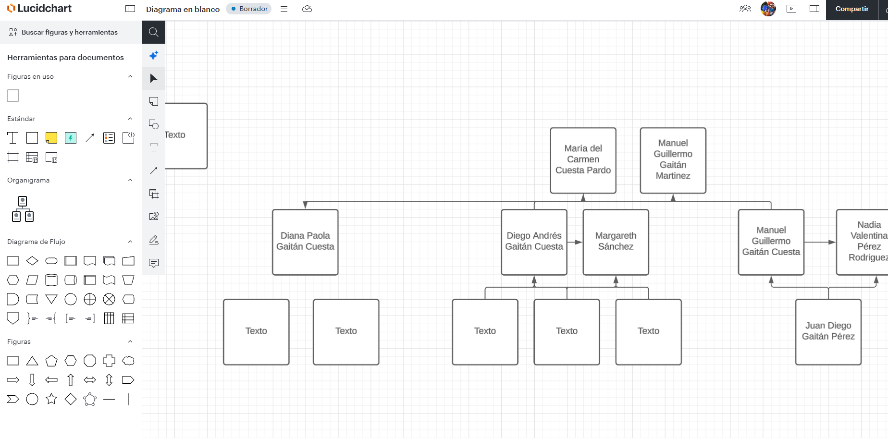

# DOSW_ParcialT2_JuanGaitan

## Indice
1. [Datos del estudiante](#1-datos-del-estudiante)
2. [Descripcion del proyecto](#2-descripcion-del-proyecto)
3. [Despliegue](#3-despliegue)
4. [Estructura del proyecto](#4-estructura-del-proyecto)
5. [Tecnologias y dependencias](#5-tecnologias-y-dependencias)
6. [Configuracion y variables de entorno](#6-configuracion-y-variables-de-entorno)
7. [Como ejecutar](#7-como-ejecutar)
8. [Pruebas](#8-pruebas)
9. [Docker](#9-docker)
10. [CI/CD](#10-cicd)
11. [Herramientas de modelado y diseno (evidencias)](#11-herramientas-de-modelado-y-diseno-evidencias)

---

## 1. Datos del estudiante
- **Nombre completo:** Juan Diego Gaitan Perez
- **Materia:** Desarrollo y Operacion de Software (DOSW)
- **Grupo:** 1
- **Periodo Academico:** 2026-01
- **Profesor agregado al repositorio:** Si

---

## 2. Descripcion del proyecto
Servicio backend RESTful desarrollado sobre la plataforma Spring Boot 3 y Java 21 como base de arquitectura para el Parcial Practico del Segundo Tercio de la asignatura DOSW. La aplicacion implementa una arquitectura por capas (MVC desacoplado) con persistencia documental no relacional en MongoDB y mecanismos de seguridad perimetral mediante Spring Security y JSON Web Tokens (JWT). El proposito principal del servicio es proporcionar un entorno desacoplado, escalable y observable para la gestion de recursos de dominio, preparado para despliegue automatizado en contenedores y plataformas en la nube.

---

## 3. Despliegue
El servicio se encuentra desplegado y en ejecucion continua en Azure App Service (Linux Containers):

- **URL base del servicio en Azure:**  
  https://dows-parcial-t2-bmhrbwbzdsafe8cm.eastus-01.azurewebsites.net
- **URL del endpoint de salud (Health Check):**  
  https://dows-parcial-t2-bmhrbwbzdsafe8cm.eastus-01.azurewebsites.net/api/v1/health
- **URL de la documentacion interactiva (Swagger UI):**  
  https://dows-parcial-t2-bmhrbwbzdsafe8cm.eastus-01.azurewebsites.net/swagger-ui/index.html
- **URL de la especificacion OpenAPI (JSON):**  
  https://dows-parcial-t2-bmhrbwbzdsafe8cm.eastus-01.azurewebsites.net/v3/api-docs

---

## 4. Estructura del proyecto

```text
DOSW_ParcialT2_JuanGaitan/
├── docs/
│   ├── uml/                                  # Diagramas fuente del sistema (arquitectura, dominio, secuencia)
│   └── images/                               # Exportes graficos, diagramas y capturas de evidencia para documentacion
│
├── src/
│   ├── main/
│   │   ├── java/edu/dosw/parcial/
│   │   │   ├── controller/                   # Controladores REST que exponen las rutas HTTP publicas y privadas
│   │   │   │   ├── dtos/
│   │   │   │   │   ├── request/              # Data Transfer Objects de entrada recibidos por los endpoints
│   │   │   │   │   └── response/             # Data Transfer Objects de salida emitidos hacia los clientes HTTP
│   │   │   │   ├── mappers/                  # Mapper IN: Transformacion bidireccional DTO <-> Objeto de Dominio
│   │   │   │   └── handlers/                 # Manejadores globales de excepciones (@ControllerAdvice y ResponseEntityExceptionHandler)
│   │   │   │
│   │   │   ├── core/
│   │   │   │   ├── services/                 # Logica de negocio y casos de uso centrales de la aplicacion
│   │   │   │   ├── models/                   # Modelos puros del dominio (entidades de negocio independientes de base de datos)
│   │   │   │   ├── validators/               # Validaciones de reglas de negocio y restricciones complejas de dominio
│   │   │   │   └── utils/                    # Clases de utilidad comun, helpers y constantes transversales
│   │   │   │
│   │   │   ├── persistence/
│   │   │   │   ├── entities/                 # Documentos de persistencia anotados con @Document especificos de MongoDB
│   │   │   │   ├── repositories/             # Interfaces de acceso a datos que extienden de MongoRepository
│   │   │   │   └── mappers/                  # Mapper OUT: Transformacion bidireccional Objeto de Dominio <-> Documento MongoDB
│   │   │   │
│   │   │   ├── config/                       # Configuraciones de infraestructura (Spring Security, OpenAPI/Swagger, Cors)
│   │   │   └── main/                         # Punto de entrada de la aplicacion que contiene la clase @SpringBootApplication
│   │   │
│   │   └── resources/
│   │       └── application.yaml              # Configuracion centralizada de propiedades y perfiles del aplicativo
│   │
│   └── test/
│       ├── java/edu/dosw/parcial/
│       │   ├── controller/                   # Pruebas unitarias y de integracion de controladores REST
│       │   ├── core/                         # Pruebas unitarias de servicios de logica de negocio y validadores
│       │   └── persistence/                  # Pruebas de repositorios y conversion de entidades de base de datos
│       └── resources/                        # Configuracion de propiedades y recursos exclusivos de pruebas
│
├── Dockerfile                                # Definicion de construccion multietapa para la imagen OCI/Docker del servicio
├── .dockerignore                             # Exclusion de archivos no requeridos en el contexto de compilacion Docker
├── .github/workflows/
│   └── ci-cd.yml                             # Definicion del pipeline automatizado de integracion y despliegue continuo
├── pom.xml                                   # Descriptor de dependencias, plugins y configuracion del ciclo de vida Maven
├── .gitignore                                # Exclusiones de control de versiones Git para binarios y credenciales
└── README.md                                 # Documentacion integral del proyecto
```

---

## 5. Tecnologias y dependencias

| Tecnologia / Dependencia | Version | Proposito |
| :--- | :--- | :--- |
| **Java Development Kit (JDK)** | 21 | Entorno de ejecucion y lenguaje principal de desarrollo. |
| **Spring Boot** | 3.2.4 | Framework base para inversion de control, configuracion automatica y ejecucion de microservicios. |
| **spring-boot-starter-web** | 3.2.4 | Provee el servidor embebido Apache Tomcat y soporte para APIs REST con Spring MVC. |
| **spring-boot-starter-data-mongodb** | 3.2.4 | Soporte de persistencia reactiva y no relacional sobre MongoDB mediante repositorios orientados a documentos. |
| **spring-boot-starter-validation** | 3.2.4 | Validacion declarativa de campos en DTOs basada en la especificacion Jakarta Bean Validation. |
| **spring-boot-starter-security** | 3.2.4 | Marco de seguridad perimetral para autenticacion, autorizacion y proteccion de endpoints. |
| **JJWT (jjwt-api, impl, jackson)** | 0.12.3 | Generacion, firmado criptografico y validacion de tokens JSON Web Token (JWT). |
| **springdoc-openapi-starter-webmvc-ui** | 2.5.0 | Generacion automatica de documentacion OpenAPI 3.0 e interfaz grafica interactiva Swagger UI. |
| **Project Lombok** | 1.18.30 | Reduccion de codigo repetitivo (getters, setters, constructores y generacion de loggers SLF4J). |
| **MapStruct** | 1.5.5.Final | Generacion automatica en tiempo de compilacion de mappers de alto rendimiento entre DTOs, Dominio y Documentos. |
| **spring-boot-starter-test** | 3.2.4 | Conjunto de utilidades de pruebas automatizadas que integra JUnit 5, Mockito y AssertJ. |
| **spring-security-test** | 3.2.4 | Utilidades especializadas para evaluar controladores y rutas protegidas con Spring Security. |
| **JaCoCo Plugin** | 0.8.12 | Generacion de reportes de cobertura de codigo de pruebas unitarias. |
| **SonarQube Plugin** | 3.10.0.2594 | Analisis estatico de codigo, calidad, cobertura y deteccion de deuda tecnica. |
| **Docker Engine** | 24.x+ | Contenedorizacion de la aplicacion en imagenes portables y livianas. |
| **Azure App Service & Azure Cosmos DB** | N/A | Infraestructura en la nube para alojamiento de contenedores Linux y motor de base de datos MongoDB v7.0. |

---

## 6. Configuracion y variables de entorno

Las siguientes variables de entorno controlan el comportamiento del sistema. Ninguna credencial ni clave privada esta registrada de forma fija en el repositorio.

| Variable | Descripcion | Valor de ejemplo (referencial) |
| :--- | :--- | :--- |
| `PORT` | Puerto de red sobre el cual el servidor HTTP embebido escucha peticiones. | `8080` |
| `MONGODB_URI` | Cadena de conexion completa al cluster de base de datos MongoDB incluyendo credenciales y nombre de base de datos. | `mongodb+srv://<usuario>:<password>@cluster.mongodb.net/dosw_parcial?tls=true` |
| `JWT_SECRET` | Clave criptografica codificada en Base64 con longitud minima de 44 caracteres (256 bits) para firma de tokens. | `kawhjkwda89j082njkHJHDW8YU99¿POAKSD00jkkja9idja0j8a7w8djaklsdjn8yh8hawdasd` |
| `WEBSITES_PORT` | Variable requerida en Azure App Service para enrutar el trafico publico hacia el contenedor Docker. | `8080` |

---

## 7. Como ejecutar

### 7.1. Ejecucion de MongoDB local con Docker
Para ejecutar una instancia limpia de MongoDB en local:

```bash
docker run -d --name mongo-parcial -p 27017:27017 -e MONGO_INITDB_DATABASE=dosw_parcial mongo:7
```

### 7.2. Ejecucion local con Maven
Asegurarse de tener configuradas las variables de entorno en la terminal o a traves de un archivo `.env`:

En PowerShell (Windows):
```powershell
$env:MONGODB_URI="mongodb://localhost:27017/dosw_parcial"
$env:JWT_SECRET="kawhjkwda89j082njkHJHDW8YU99¿POAKSD00jkkja9idja0j8a7w8djaklsdjn8yh8hawdasd"
mvn spring-boot:run
```

En Bash (Linux/macOS):
```bash
export MONGODB_URI="mongodb://localhost:27017/dosw_parcial"
export JWT_SECRET="kawhjkwda89j082njkHJHDW8YU99¿POAKSD00jkkja9idja0j8a7w8djaklsdjn8yh8hawdasd"
mvn spring-boot:run
```

### 7.3. Ejecucion local con Docker
1. Compilar y empaquetar la imagen Docker:
   ```bash
   docker build -t dosw-parcial:local .
   ```

2. Ejecutar el contenedor pasando las variables requeridas:
   ```bash
   docker run -d -p 8080:8080 --name dosw-parcial-app -e MONGODB_URI="mongodb://host.docker.internal:27017/dosw_parcial" -e JWT_SECRET="kawhjkwda89j082njkHJHDW8YU99¿POAKSD00jkkja9idja0j8a7w8djaklsdjn8yh8hawdasd" dosw-parcial:local
   ```

3. Verificar acceso en el navegador:
   - Endpoint de salud: http://localhost:8080/api/v1/health
   - Swagger: http://localhost:8080/swagger-ui.html

### 7.4. Detener y limpiar contenedores locales
Para liberar recursos del sistema (RAM, CPU y puertos de red) al finalizar las pruebas locales:

```bash
docker stop dosw-parcial-app mongo-parcial
docker rm dosw-parcial-app mongo-parcial
```

---

## 8. Pruebas

### 8.1. Ejecucion de la suite de pruebas
Para ejecutar las pruebas unitarias y de integracion:
```bash
mvn clean test
```

Para generar la verificacion completa con reporte de JaCoCo:
```bash
mvn verify
```

El reporte de cobertura generado por JaCoCo queda disponible en:
```text
target/site/jacoco/index.html
```

### 8.2. Evidencias de pruebas y cobertura


- **Ejecucion de pruebas en verde:**
  

- **Reporte de cobertura JaCoCo:**
  

---

## 9. Docker

### 9.1. Comandos de construccion y ejecucion
- **Construccion de la imagen multietapa:**
  ```bash
  docker build -t juandiegogta/dosw-parcial-t2:latest .
  ```
- **Ejecucion del contenedor:**
  ```bash
  docker run -d -p 8080:8080 --name parcial-container -e JWT_SECRET="kawhjkwda89j082njkHJHDW8YU99¿POAKSD00jkkja9idja0j8a7w8djaklsdjn8yh8hawdasd" juandiegogta/dosw-parcial-t2:latest
  ```

### 9.2. Evidencia de ejecucion en Docker


- **Contenedor en ejecucion local (`docker ps` o Docker Desktop):**
  

---

## 10. CI/CD

### 10.1. Descripcion del Pipeline
El flujo de automatizacion esta definido en `.github/workflows/ci-cd.yml` y se activa con eventos de `push` sobre las ramas `main` y `develop`. Consta de tres trabajos secuenciales:

1. **Job `test`:**
   - Descarga el repositorio mediante `actions/checkout@v4`.
   - Prepara el entorno JDK 21 Temurin con cache de dependencias Maven.
   - Ejecuta `mvn verify --no-transfer-progress` para validar sintaxis, compilar y ejecutar la suite de pruebas automatizadas con analisis de cobertura.
2. **Job `docker`:**
   - Depende de la finalizacion exitosa de `test`.
   - Se autentica contra Docker Hub usando las credenciales del repositorio.
   - Construye y publica la imagen Docker en el registro publico bajo la etiqueta `:latest`.
3. **Job `deploy`:**
   - Depende de la finalizacion exitosa de `docker`.
   - Autentica contra Azure usando un Service Principal (`azure/login@v2`).
   - Notifica a Azure App Service (`azure/webapps-deploy@v3`) la actualizacion de la imagen para desplegar el contenedor en el entorno productivo.

### 10.2. Secrets utilizados en GitHub Actions
Los siguientes secretos fueron configurados en el repositorio (sin exponer sus valores):
- `DOCKERHUB_USERNAME`: Identificador del usuario propietario de la cuenta en Docker Hub.
- `DOCKERHUB_TOKEN`: Personal Access Token generado en Docker Hub para operaciones de publicacion.
- `AZURE_CREDENTIALS`: Bloque JSON de autenticacion del Service Principal con permisos sobre el grupo de recursos de Azure.
- `AZURE_WEBAPP_NAME`: Nombre del App Service aprovisionado en Azure (`dows-parcial-t2`).
- `JWT_SECRET`: Llave criptografica en Base64 inyectada durante la ejecucion de pruebas y el inicio del servicio.

### 10.3. Evidencias del pipeline


- **Pipeline ejecutado exitosamente en GitHub Actions:**
  

---

## 11. Herramientas de modelado y diseno (evidencias)

Evidencias de configuracion y acceso a las plataformas de modelado y diseno arquitectonico:

### 11.1. Cuenta y espacio de trabajo en herramienta de diagramacion (Lucidchart / Draw.io / Miro)



### 11.2. Cuenta y espacio de trabajo en herramienta de prototipado (Figma)


